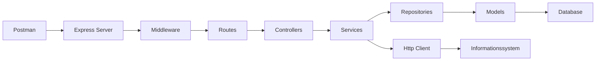

# spacerescue

## Projekt Beskrivelse

## Arkitektur & Startvejledning
### Arkitekturdiagram


### 5.3 Arbejdsspørgsmål
1. **Hvorfor er én stor server.js med endpoints, databasekald og regler en dårlig idé?**

   - At have alt i samme fil er i længden meget svært at vedligeholde. Det ender med man bare tilføjer mere og mere kode i samme fil, hvlket gør det svært at finde rundt i koden. Det fører til manglende struktur / overblik, hvilket gør det svære at se hvor man skal tilføje ny kode, og hvor man skal ændre eksisterende kode.

2. **Hvad er forskellen på en controller og en service?**
   
    - Forskellen på en controller og en service er, at controlleren er ansvarlig for at håndtere HTTP-requests og sende svar tilbage til klienten, mens servicen indeholder forretningslogikken. Controlleren fungerer som et mellemled mellem klienten og servicen, hvilket hjælper med at holde koden organiseret og adskilt.

3. **Hvilket lag skal kontrollere, om Orion allerede er tildelt?**
   
    - Det er servicen, der skal kontrollere, om Orion allerede er tildelt. Dette er fordi, at servicen indeholder forretningslogikken og har ansvaret for at håndtere data og regler.

4. **Hvor placerer I MongoDB-forespørgsler – og hvorfor?**

    - MongoDB-forespørgsler placeres i repository-laget. Grunden er, at repository-laget har ansvaret for at interagere med databasen og udføre CRUD-operationer.

5. **Hvordan kan I teste forretningslogik uden at starte HTTP-serveren?**

    - Forretningslogik kan testes uden at starte HTTP-serveren ved at skrive unittests for service-laget. Det kan man gøre ved at isolere servicen og teste dens metoder direkte.

### Startvejledning
1. Klon projektet
         ```
         git clone <repository-url>
         ```
2. Kør `npm install` for at installere afhængighederne.
3. Start en MongoDB-instans med databasen `spacerescueDB`.
4. Opret eventuelt en `.env`-fil med `MONGODB_URI` og `PORT`.
5. Kør `npm run dev` for at starte serveren på port 3000.

Serveren logger `connected to mongoDB`, når forbindelsen er oprettet, og kan kontrolleres
med `GET /health`.